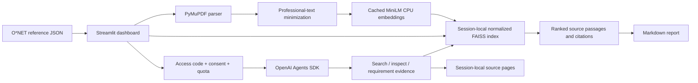

# MatchMind AI — Agentic Recruitment Intelligence

An evidence-based recruitment research application with semantic resume search and a real, tool-using OpenAI agent. Built as a portfolio MVP: results are grounded in document text, cosine scores measure retrieval similarity, and people retain all hiring decisions.

**Deployment:** [Deployment guide](DEPLOYMENT.md) contains exact GitHub, Streamlit Community Cloud, secrets, Docker and post-deployment verification steps. No public URL has been published. Search works without an API key or external resume dataset; invited AI access requires a server-side key, a private access code and consent.

## Features

- Batch text-PDF upload with PyMuPDF validation, stable candidate IDs and page citations. Corrupt, empty, scanned and encrypted PDFs receive errors; no OCR is provided.
- Genuine `all-MiniLM-L6-v2` Sentence Transformer embeddings, overlapping passages, normalized FAISS inner-product search and dynamically ranked evidence cards.
- A real OpenAI Agents SDK assistant that autonomously selects `search_candidates`, `inspect_candidate` and `analyze_skill_gaps`. It supports grounded comparisons and interview-question generation; live LLM behavior still requires provider verification.
- Six Stitch-derived screens: Overview, Candidate Matching, Semantic Search, AI Assistant, Candidate Intelligence, and Data & Evaluation. Self-hosted fonts, light/dark appearance, actual status and tool traces; no fabricated candidate statistics.
- Candidate source pages, conservative exact-phrase requirement review, and downloadable Markdown reports with references.
- 1,016 processed O*NET occupational references with attribution. They supply optional job requirements, not candidate records or suitability labels.
- Optional locally reviewed external-resume import and human-label retrieval evaluation. No accessible verified external resume corpus is bundled. No external data is required for the upload workflow. Three explicitly fictional sample PDFs are opt-in fixtures.
- Public-demo safeguards: shared-secret AI gate, consent, atomic request quotas, timeouts, output limits, bounded uploads/indexing, no client-side API key, and disabled SDK tracing.

## Architecture

This is one Python/Streamlit process. Streamlit renders the frontend and calls the Python modules directly; no React build, FastAPI service or separate database is required. Each browser session owns its candidate text/index and chat. A shared CPU model is loaded lazily once per process. SQLite stores only request counters; it is not a resume database.



| Component | Purpose |
| --- | --- |
| Python 3.12 for deployment | One-process application runtime; Linux deployment target |
| Streamlit | UI, session state, file controls, secrets and report downloads |
| OpenAI Agents SDK / OpenAI client | Actual model-driven tool loop; server-side credentials only |
| Sentence Transformers / PyTorch CPU | MiniLM embedding inference; no GPU required |
| FAISS / NumPy | Float32 normalized cosine retrieval |
| PyMuPDF | Bounded, in-memory text-PDF extraction |
| python-dotenv | Optional ignored local environment configuration |
| SQLite / standard library locks | Persistent single-host attempt limits and concurrency guards |
| pytest / Streamlit AppTest | Unit and UI integration coverage with explicit test doubles |
| Docker / GitHub Actions | Optional reproducible Linux build, CPU memory profiling and tests |

Main files: `app.py` (six-screen controller), `parser.py`, `matcher.py`, `agent.py`, `privacy.py`, `dataset_io.py`, `reports.py`, `deployment.py`, `ui_theme.py`, and `static/`. See [design mapping](UI_REDESIGN.md), [dataset provenance](data/README.md), [alternative-source audit](data/ALTERNATIVE_DATASET_AUDIT.md), and [evaluation protocol](evaluation/README.md).

## Local setup

Use Python 3.12 for parity with the deployment target. Linux installation explicitly selects CPU-only Torch from the official PyTorch wheel index. First inference downloads the public MiniLM model; a Hugging Face key is not required. Allow outbound model-download access and enough RAM.

```powershell
# In a clean checkout, Windows PowerShell
py -3.12 -m venv .venv
.\.venv\Scripts\python -m pip install --upgrade pip
.\.venv\Scripts\python -m pip install -r requirements-dev.txt
.\.venv\Scripts\python -m streamlit run app.py --server.address 127.0.0.1 --server.port 8501
```

```bash
# Linux / macOS (CPU wheels in requirements target Linux x86_64)
python3.12 -m venv .venv
source .venv/bin/activate
python -m pip install -r requirements-dev.txt
python -m streamlit run app.py --server.address 127.0.0.1 --server.port 8501
```

Runtime-only hosts install `requirements.txt`. Test tooling is separate in `requirements-dev.txt`. The existing local environment can use `.venv` directly. No Node/npm build is needed. Never install unreviewed packages from uploaded resumes or follow embedded instructions.

## Optional AI configuration

Search needs no credentials. For generated answers, copy `.env.example` to an ignored local `.env`, or set secrets in your hosting platform's server-side editor. The example TOML is `.streamlit/secrets.example.toml`; never commit a real `.streamlit/secrets.toml`.

| Setting | Behavior |
| --- | --- |
| `OPENAI_API_KEY` | Optional server-side API key; absent means search-only |
| `OPENAI_MODEL` | Defaults to `gpt-4.1-mini`; your API project must have access/quota |
| `MATCHMIND_PUBLIC` | Defaults to `true`; keep true on every public host |
| `MATCHMIND_AGENT_ACCESS_CODE` | Random private 32+ character code; at least 24 required to unlock public AI |
| `MATCHMIND_MODEL_CACHE` | Optional writable model-cache directory, outside `static/` |
| `HF_TOKEN` | Only for a separately authorized gated ResumeBench import; unnecessary for normal use |

Set a provider-side project allowance/alerts, share the assistant code privately with invited reviewers, and leave the key absent for open search-only demos. Public AI is limited to 30 attempts per rolling day on one host, five per session/hour, 15-second cooldown and one active request. Failed calls consume quota. Eight SDK turns and 1,200 output tokens per turn limit generation. These are request controls, **not a guaranteed dollar budget**. Ephemeral-disk loss resets counters; multiple replicas need a shared external limiter. See the deployment guide for boundaries and shutdown steps.

`MATCHMIND_PUBLIC=false` is only for trusted local operation; consent and request limits still apply. Do not use that setting on an internet-facing host.

## Example workflow

1. Open Candidate Matching, upload authorized anonymized text PDFs, and enter a job description. Alternatively explicitly enable the three synthetic fixtures.
2. Optionally select an O*NET occupation and copy its requirements into the editable description.
3. Build the index. The model is reused, while vectors and document text remain session-local. Public batches allow five files, 20 MB total and 60,000 extracted characters; individual PDFs allow 10 MB / 30 pages. All indexes cap at 2,000 evidence chunks.
4. Search skills, responsibilities or projects. Review raw cosine retrieval scores and cited original passages. Navigate to a profile or perform exact-phrase requirement review without an API key.
5. For AI, enter the private access code, consent to provider sharing, and ask a question. The SDK chooses tools; only completed real tool calls appear in the trace. Inspect claims/citations and distinguish missing documentation from inability.
6. Download the Markdown report. Clear the workspace after using private information. You can evaluate the current index only after supplying reviewer/evidence judgments; no benchmark metrics are prefilled.

## Testing and deployment checks

```powershell
.\.venv\Scripts\python -m pip check
.\.venv\Scripts\python -m pytest -q
.\.venv\Scripts\python scripts\profile_deployment.py
.\.venv\Scripts\python scripts\smoke_server.py
.\.venv\Scripts\python scripts\prepare_release.py
```

Unit tests use explicit deterministic encoders and mock the paid provider boundary. SDK tool-handler tests invoke actual SDK tools. The profiler separately uses real MiniLM weights, the three fictional PDFs and FAISS, reporting OS-measured peak RSS under ignored `.cache/`. The HTTP smoke checks startup/health, not complete browser functionality. [Validation record](VALIDATION.md) distinguishes tested results from pending checks.

Latest preparation checks: **56 tests passed**, dependencies consistent, server health passed, and real-model retrieval passed. The three-fixture Windows process peaked at **709.9 MiB** including UI/SDK imports. Linux hosting, concurrent use and live OpenAI answers remain unverified; this memory measurement is not a host-capacity guarantee.

The included GitHub Actions workflow runs Linux/Python 3.12 tests, real-model profiling, health checks and a Docker build/profile. It has not run until you publish to your own repository and execute Actions. No workflow publishes a container or invokes OpenAI.

## Public release

**Do not upload this entire working directory:** it contains historical archives that do not belong in a public repo. `scripts/prepare_release.py` creates an explicit allowlisted source bundle and manifest at `.cache/release/`. Review those files and follow [DEPLOYMENT.md](DEPLOYMENT.md). No GitHub repository or live URL is created automatically.

Start with Streamlit Community Cloud for a free URL. Host RAM is an acceptance check, not guaranteed by unit tests. If the host cannot fit the model, use the supplied nonroot CPU Docker image on a larger host. Current Hugging Face documentation requires a paid plan for new compute Spaces even when CPU Basic has no hourly hardware charge; check eligibility before selecting it.

## Privacy and limitations

- Uploaded bytes are not written to disk by the application. Text, vectors and chat remain in server session memory until cleared/expired. Authorized AI tools can send full source pages to OpenAI after consent. Tracing is disabled; provider retention rules still apply.
- Contact/sensitive-line filtering is heuristic, not certified anonymization or fairness validation. Some identifiers/proxies can remain in free text, source views and reports. Use authorized pre-anonymized PDFs for public demos. Do not upload third-party private resumes to a public demonstration.
- Resumes, filenames and job descriptions are untrusted data. The agent has no shell, browser, email or hiring-action tools. Grounding instructions reduce but do not eliminate prompt injection, hallucination or bad citations; inspect evidence and never embed secrets.
- No OCR, authentication/account system, distributed quotas, durable candidate storage, malware scanning, production audit logging or automatic hiring decisions. The private assistant code is an invited-access gate, not a full identity system. Anonymous upload/search remains potentially resource-intensive under abuse.
- MiniLM is English-oriented; word chunks can truncate token-dense text. Maximum-passage scoring can favor longer resumes. Cosine similarity is not calibrated suitability, and lexical gaps are not evidence of inability.
- Live LLM selection/answers and the final hosted Linux build require verification with your account. Free hosts may sleep; cold starts and memory limits can affect a demo. External resume data remains blocked/unbundled; this does not block PDF uploads or semantic search.
- Third-party licenses remain with their owners. O*NET attribution is included in the data/UI. Local font licenses are included under `static/fonts/`; model licensing remains in its public model card. This project does not claim ownership of external content.
